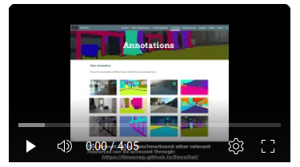

<div align="center">

# EnvoDat

**A Large-Scale Multisensory Dataset for Robotic Spatial Awareness and Semantic Reasoning in Heterogeneous Environments**

[](https://linusnep.github.io/EnvoDat/)
[](https://pypi.org/project/envodat/)
[](https://ieeexplore.ieee.org/document/11127594)
[](https://arxiv.org/abs/2410.22200)
[](https://huggingface.co/datasets/Linpen/EnvoDat)
[](https://creativecommons.org/licenses/by/4.0/)

📖 [Documentation](https://linusnep.github.io/EnvoDat/) | 🌐 [Project Website](https://sites.google.com/view/envodat/overview) | ⚙️ [Install](docs/installation.md) | 🧪 [Examples](docs/examples.md) | 🏆 [Leaderboard](docs/benchmark.md) | 🤗 [Hugging Face](https://huggingface.co/datasets/Linpen/EnvoDat) | 📥 [Download](https://sites.google.com/view/envodat/download) | ⚖️ [License](https://creativecommons.org/licenses/by/4.0/)


---

</div>

## Overview

EnvoDat is a large-scale, multisensory robotics dataset captured across **heterogeneous indoor, outdoor, and subterranean environments**, with annotations and ground truth designed for tasks such as:

1. **Spatial awareness:** SLAM and odometry benchmarking under dynamic entities, varying illumination, opaque surfaces, low/zero-visibility, and feature-sparse conditions.
2. **Semantic reasoning:** Object detection and semantic perception on non-standard objects, terrain, and lighting that differ from common household/urban datasets.

Here, we provide the **`envodat` toolkit** (`pip install envodat`) and the **development and benchmarking kit** to download and load the data, reproduce the perception experiments, evaluate SLAM trajectories, and submit results to the public leaderboard. The annotated scenes can be pulled straight from the Hugging Face Hub for training, while the raw sensor data is hosted on our server (see [Download](#download)).

## Summary Video

<p align="center">
  <a href="https://youtu.be/5OcByVmTUPQ">
    
  </a>
</p>

## Download

EnvoDat is available from two places, depending on what you need:

| Source | Contents | Best for |
|--------|----------|----------|
| 🤗 [Hugging Face Hub](https://huggingface.co/datasets/Linpen/EnvoDat) | Annotated scenes, training-ready (YOLO layout + 🤗 `datasets` configs) | Training and evaluating ML models |
| 📥 [EnvoDat Download](https://sites.google.com/view/envodat/download) | Full release: raw ROS bags (RGB, LiDAR, depth, IMU), ground-truth poses, and all annotation formats (YOLO, COCO, OpenAI-CLIP, VOC, …) | SLAM/odometry, multisensor research, other formats |

To fetch scenes from the Hub, either use the helper script or load them directly with 🤗 `datasets`:

```bash
pip install envodat
envodat list                       # available scenes
envodat download mu-hall           # one scene, YOLO-ready
```

```python
from datasets import load_dataset
ds = load_dataset("Linpen/EnvoDat", "mu-hall")   # train / validation / test splits
```

See [`docs/huggingface.md`](docs/huggingface.md) for the Hub layout and version pinning, and [`docs/examples.md`](docs/examples.md#download-raw-data) for downloading raw data from the CPS server.

## Quickstart

```bash
pip install "envodat[all]"
```

```python
import envodat as ed

ed.init("./envodat_data")                    # where the data is stored
ed.download("mu-hall")                       # training-ready scene from Hugging Face
ds = ed.load("mu-hall")                      # 🤗 datasets: train / validation / test
loader = ed.dataloader("mu-hall", split="train", batch_size=8)   # PyTorch
ed.train_yolo("mu-hall", model="yolo11n.pt", epochs=100)         # Ultralytics YOLO
ed.evaluate_traj("my_slam.tum", "gt-poses-mu-hall.csv")          # ATE / RPE / scale drift
```

The same is available from the command line (`envodat download mu-hall`, `envodat train mu-hall`, `envodat eval ...`). The [documentation](https://linusnep.github.io/EnvoDat/) covers [installation](docs/installation.md), [examples](docs/examples.md) including training with 🤗 Transformers, the [API](docs/api.md), the [modalities](docs/modalities.md) and [environments](docs/environments.md), and a full [YOLO walkthrough](docs/get_started.md).

## Benchmark & Leaderboard

The public leaderboard can be found in [`docs/benchmark.md`](docs/benchmark.md) and covers two tracks:

- **SLAM track** — RTAB-Map, ORB-SLAM3, HDL-SLAM, FAST-LIO2, DLIO across five representative scenes, scored by ATE, RPE, and scale drift.
- **Detection track** — object detectors evaluated with mAP on EnvoDat scenes.

To reproduce or contribute results, see [How to submit](docs/benchmark.md#how-to-submit) and [`CONTRIBUTING.md`](CONTRIBUTING.md).

## Paper Citation

If you use this work in your research, please cite our [paper](https://ieeexplore.ieee.org/abstract/document/11127594) and [dataset](https://linusnep.github.io/EnvoDat/) using the following BibTeX entry:

```bibtex
@INPROCEEDINGS{11127594,
  author={Nwankwo, Linus and Ellensohn, Björn and Dave, Vedant and Hofer, Peter and Forstner, Jan and Villneuve, Marlene and Galler, Robert and Rueckert, Elmar},
  booktitle={2025 IEEE International Conference on Robotics and Automation (ICRA)}, 
  title={EnvoDat: A Large-Scale Multisensory Dataset for Robotic Spatial Awareness and Semantic Reasoning in Heterogeneous Environments}, 
  year={2025},
  volume={},
  number={},
  pages={153-160},
  keywords={Simultaneous localization and mapping;Annotations;Heuristic algorithms;Supervised learning;Semantics;Benchmark testing;Cognition;Spatial databases;Robustness;Sensors},
  doi={10.1109/ICRA55743.2025.11127594}}
```
## Dataset

```bibtex
@software{envodat,
    author = {Linus Nwankwo and Bjoern Ellensohn and Vedant Dave and Peter Hofer and Jan Forstner and Marlene Villneuve and Robert Galler and Elmar Rueckert},
    title = {EnvoDat: A Large-Scale Multisensory Dataset for Robotic Spatial Awareness and Semantic Reasoning in Heterogeneous Environments},
    note = {Project Website: \url{https://linusnep.github.io/EnvoDat/}},
    eprint={2410.22200},
    archivePrefix={arXiv},
    url={https://linusnep.github.io/EnvoDat/}
}
```

## License

The dataset and documentation are licensed under [Creative Commons Attribution 4.0 International (CC BY 4.0)](https://creativecommons.org/licenses/by/4.0/).
The code/scripts in this repository are released under the [MIT License](LICENSE-CODE). (Creative Commons recommends against using CC licenses for software, hence the separate code license.)

## Acknowledgement

This project has received funding from the Deutsche Forschungsgemeinschaft (DFG, German Research Foundation), No. #430054590 (TRAIN).
